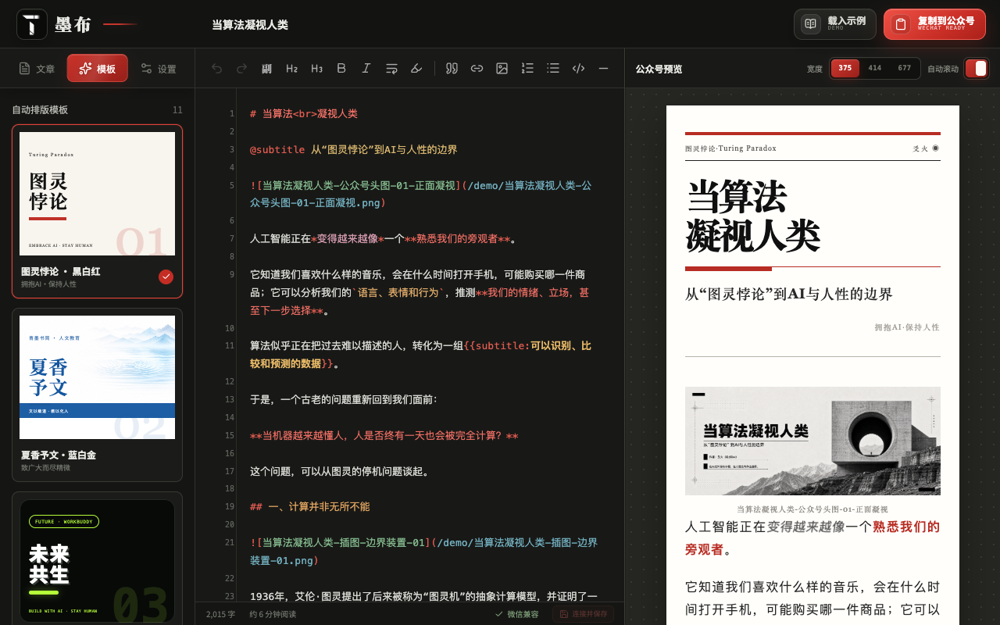

# 墨布自排 · Inkment Auto Layout

**墨布自排是服务于 [墨布编辑器（Inkment）](https://inkment.galegram.com/) 的配套 Codex Skill。** 根据文章内容识别排版结构，将 Markdown、Word 正文与配套图片整理为可直接导入墨布的 Markdown 项目。

[访问墨布官网](https://inkment.galegram.com/) · [打开墨布编辑器](https://inkment.galegram.com/editor)

[](https://inkment.galegram.com/editor)

*墨布编辑器界面示例。点击样图可打开编辑器。*

**原则：不改变原文，只调整排版语法。** 保留文字、标点、数值和正文顺序，不润色、不续写、不摘要；图片采用规范命名和相对路径，原始素材保留归档。

这是在 Codex 中使用的 Skill。文章识别与排版由 Codex 按照 Skill 指令完成，仓库中的 Python 脚本负责检查输出结构与引用。

## 与墨布编辑器配合使用

墨布自排负责准备文章：识别墨布语法、整理 Word／Markdown、匹配图片并输出规范项目。墨布编辑器负责呈现与发布准备：导入项目、选择视觉模板、实时预览和复制公众号排版内容。

使用路径：**提供原文与配图 → Codex 自排 → 生成 Markdown 项目 → 导入墨布编辑器 → 预览并复制。**

本 Skill 的语法与输出目录围绕墨布编辑器设计，生成结果需要在墨布中检查实际呈现；Skill 本身不包含编辑器。

## 功能

| 功能 | 说明 |
| --- | --- |
| 文档识别 | 支持 `.md`、`.markdown`、`.docx` 及配套图片；旧版 `.doc` 需先另存为 `.docx` |
| 内容感知排版 | 根据观点、叙事、教程、研究、访谈、通知等文章类型判断结构与阅读节奏 |
| 标题层级 | 从原文识别主标题、副标题、二级与三级标题；没有明确副标题时不补写 |
| 强调与引用 | 区分重点、粗体、斜体和真实引语，避免重复强调与整段加粗 |
| 结构整理 | 按原有语义识别列表、表格、链接、行内代码、代码块、换行与分割线 |
| 图片整理 | 综合画面、文件名和上下文匹配位置，规范命名，区分头图、插图与未使用素材 |
| 确认方式 | 自动确认后直接生成，或手动查看方案、按类别调整后生成 |
| 项目归档 | 按 `YYYYMMDD｜主题` 建立自包含项目，保存最终正文、图片、原始素材与清单 |
| 结果检查 | 检查目录结构、标题层级、表格列数、代码围栏、重点标记和图片引用等 |

所有样式都依据内容使用：有真实引语才引用，有核心判断才突出重点，有二维信息关系才使用表格。先判断语义，再检查全文节奏，普通正文承担主要阅读流。

## 安装

### 方式一：让 Codex 安装

在 Codex 中发送：

```text
请使用 skill-installer，从 https://github.com/zkilxx/inkment-auto-layout 安装这个 Skill。
Skill 位于仓库根目录，安装名称为 inkment-auto-layout。
```

安装后在下一轮对话中调用 `$inkment-auto-layout`。

### 方式二：手动安装（macOS / Linux）

需要先安装 Git。在终端执行：

```bash
mkdir -p "${CODEX_HOME:-$HOME/.codex}/skills"
git clone https://github.com/zkilxx/inkment-auto-layout.git \
  "${CODEX_HOME:-$HOME/.codex}/skills/inkment-auto-layout"
```

目标目录中应能直接找到 `SKILL.md`，不要再套一层同名目录。若目录已存在，请先确认是否已经安装；已有 Git 安装可用下面的命令更新：

```bash
git -C "${CODEX_HOME:-$HOME/.codex}/skills/inkment-auto-layout" pull --ff-only
```

该方法跟随 `main` 分支。固定版本可在 [Releases](https://github.com/zkilxx/inkment-auto-layout/releases) 查看。

### 使用环境

- 在 Codex 中提供正文、图片或明确的本地素材目录，并允许读取素材、写入输出目录。
- 处理 Word 时，需要环境中可用的 DOCX 读取／转换能力。Skill 优先复用墨布项目的 Word 转换逻辑，或调用可用的 Documents Skill；本仓库不附带墨布编辑器源码与独立 Word 转换程序。
- 运行验收脚本建议使用 Python 3.10 或更新版本；脚本仅使用 Python 标准库。

## 使用流程

### 1. 提供正文与素材

上传文件，或在当前任务可访问的目录中指定正文与图片。例如：

```text
使用 $inkment-auto-layout，排版这个目录里的 Word 正文和图片：
/你的素材目录
请保持原文不变，让我选择自动确认或手动确认。
```

Skill 会读取全文、查看图片，识别标题树、强调内容、引用、表格等结构，并提出图片命名与位置方案。

### 2. 选择确认模式

识别后会给出：

```text
1 自动确认并生成最终项目
2 手动确认
```

**自动确认**：回复 `1` 后直接生成最终项目，不再逐项询问。低置信度内容保留为普通正文；用途不明确的图片归档为未使用素材。

也可以在最初的请求中直接指定：

```text
使用 $inkment-auto-layout 排版这篇 Markdown 和配图，自动确认，直接生成最终项目。
```

**手动确认**：回复 `2` 后查看完整识别结果，包括主副标题、标题树、重点、粗体、引用、其他行内样式、表格／列表及图片去向，再按数字调整：

```text
1 确认以上方案并生成
2 修改主标题/副标题
3 修改分级标题
4 修改重点/粗体/斜体/引用/链接
5 修改表格/列表/代码/换行/分割线
6 修改图片名称、顺序或位置
7 查看完整 Markdown 草案（不生成文件）
```

### 3. 获得规范归档项目

默认在输入正文旁生成：

```text
YYYYMMDD｜主题/
├── 主题-墨布排版.md
├── 图片/
│   ├── 头图/
│   └── 插图/
├── 原始素材/
│   ├── 正文/
│   ├── 图片/
│   └── 未使用图片/
└── 归档清单.md
```

日期优先采用原文或项目明确日期，没有明确日期时使用生成当天。同名项目使用 `｜02`、`｜03` 等后缀另存。原文件保留，最终正文只引用 `图片/` 内实际使用的素材。

图片命名示例：

```text
图片/头图/文章主题-头图-01-主题画面.png
图片/插图/文章主题-插图-01-概念示意.png
```

`归档清单.md` 记录确认模式、结构识别数量、图片名称映射与插入位置、未使用原因和验收结果。

### 4. 导入墨布并预览

打开 [墨布编辑器](https://inkment.galegram.com/editor)，将最终 Markdown 与 `图片/` 目录一起导入，保留相对目录关系，再使用所需视觉模板预览。确认标题、重点、引用、表格与图片呈现后，使用编辑器的复制功能继续公众号排版。Skill 默认生成语义化 Markdown，不自动更换编辑器模板。

## 墨布语法示例

以下仅展示语法；实际排版中的文字必须来自原文。

```markdown
# 原文主标题

@subtitle 原文副标题


正文中的**关键词**。

## 原文章节标题

> 原文中的真实引语。

正文承接。

{{highlight:原文中的核心判断。}}

### 原文小节标题

- 原文并列项目
- 原文并列项目
```

完整规则见 [墨布语法](references/inkment-syntax.md)、[内容感知排版](references/content-aware-layout.md) 与 [Word 和图片处理](references/input-processing.md)。

## 验收

Skill 生成项目后会运行验收。也可在 Skill 仓库目录内手动执行：

```bash
python3 scripts/verify_inkment_bundle.py '/绝对路径/YYYYMMDD｜主题'
```

也支持检查单个 Markdown 文件：

```bash
python3 scripts/verify_inkment_bundle.py '/绝对路径/主题-墨布排版.md'
```

脚本通过时输出 `PASS`，发现问题时输出 `FAIL` 和原因。语义判断、原文一致性与视觉效果仍需结合全文对照及墨布预览检查；脚本通过不等于已经完成真实编辑器预览。

## 仓库文件

- [SKILL.md](SKILL.md)：Codex 执行指令与完整流程。
- [agents/openai.yaml](agents/openai.yaml)：Skill 显示名称与默认调用提示。
- [references/](references/)：语法、内容感知排版及输入处理规则。
- [scripts/verify_inkment_bundle.py](scripts/verify_inkment_bundle.py)：Markdown 与归档项目验收脚本。
- [docs/images/inkment-editor.png](docs/images/inkment-editor.png)：墨布编辑器界面样图，来自墨布官网项目中的实际界面截图。
